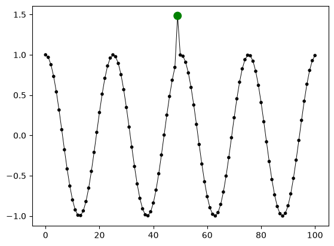
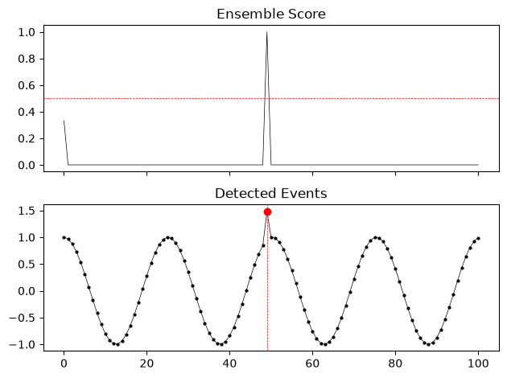
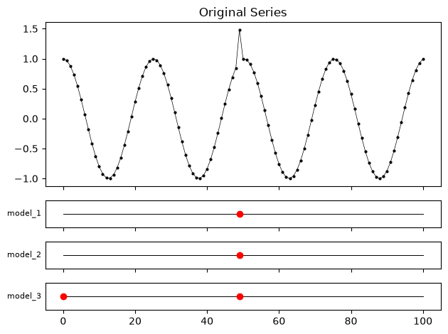

# Plotting detections

`pyharbinger` ships matplotlib helpers for inspecting detections: `har_plot` for
a single detector and `har_ensemble_plot` / `har_ensemble_plot_models` for
ensembles.


```python
from pyharbinger import har_plot, HanrFft, datasets

dataset = datasets.examples_anomalies()["simple"]
serie, event = dataset["serie"], dataset["event"]

model = HanrFft().fit(serie)
det = model.detect(serie)
ax = har_plot(model, serie, det, event)
ax.figure
```





Points are coloured by outcome against the ground truth: true positives (green),
false negatives (blue), false positives (red), and motif/discord segments
(purple). Detected change points are drawn as dashed vertical lines.

## Ensemble views


```python
from pyharbinger import (
    har_ensemble_plot,
    har_ensemble_plot_models,
    HarEnsembleFuzzy,
    HanrFbiad,
    HanrHistogram,
)

ens = HarEnsembleFuzzy(HanrFft(), HanrFbiad(), HanrHistogram()).fit(serie)
ens_det = ens.detect(serie)

# consensus score + detected events
har_ensemble_plot(ens_det, serie)
```





```python
# original series + each member detector's votes
har_ensemble_plot_models(ens_det, serie)
```





